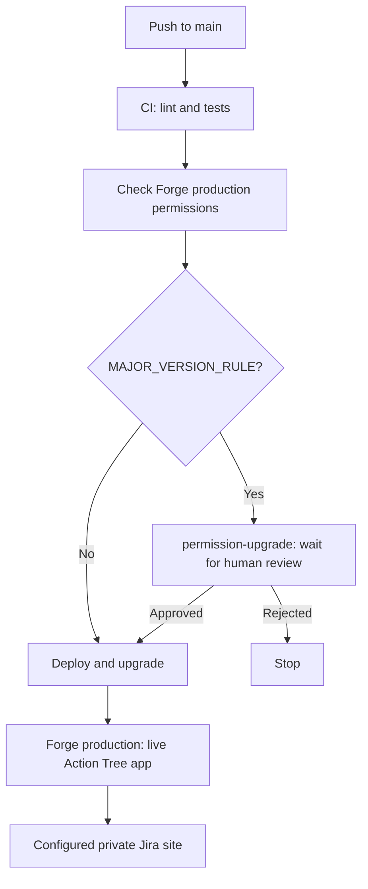

# Action Tree

Turn a nested Jira action list into a tree of linked Task issues, then replace the source list with rich issue cards.

Action Tree is an Atlassian Forge app built with native UI Kit. It supports Jira checkbox action lists and bullet lists, preserves parent-child relationships, and can resume an interrupted conversion. Application processing and conversion state stay on Atlassian; there is no external backend.

## Features

- Convert native checkbox actions or bullet points into regular **Task** issues in the same project.
- Preserve sibling order in the description and popup, and recursive parent-child relationships through issue links.
- Link children with **is subtask of** and parents with **has subtask**.
- Display nested rich Jira issue cards in both the description and the popup.
- Launch from the issue sidebar below Automation.
- Preview before creating issues and resume saved conversion progress.

The hierarchy uses issue links rather than Jira's built-in Sub-task issue type or `parent` field. This allows Tasks to nest beyond Jira's native subtask hierarchy.

## Usage

1. Open a **Task** with a native checkbox action list or bulleted list in its description.
2. In the issue's right sidebar, open **Apps → Action Tree** below **Automation** and click **Launch Action Tree**. Jira controls the sidebar panel order; use Jira's panel ordering controls if needed.
3. In **Convert List to Sub-Issues**, select a list, review its preview, and click **Create Tasks** in the persistent footer beside **Close**. The item count and conversion action stay visible while the list scrolls. Keep the modal open until conversion finishes.
4. The selected list becomes a nested bulleted list of rich Jira issue cards (ADF `inlineCard` nodes), with issue details resolved by Jira. Action Tree requests an issue-view refresh after saving, without a full-page reload. If that refresh fails, the popup confirms that the conversion is saved and asks you to reload the page.

The Action Tree popup also displays created Tasks as nested rich issue cards, both during conversion and after completion.

For example, start with these native checkbox actions (shown here in Markdown notation):

```text
- [ ] A
- [ ] B
  - [ ] C
    - [ ] D
    - [x] E
  - [ ] F
- [ ] G
```

Action Tree creates seven **Task** issues in the source issue's project. A, B and G link to the source Task; C and F link to B; D and E link to C. Each child **is subtask of** its immediate parent, and each parent **has subtask** its children. These are reciprocal views of one Jira issue link per relationship. No transitive links are added between grandchildren and grandparents.

The result is a bulleted tree of rich issue cards with the same shape. Each card resolves its issue title, type and status through Jira.

Sibling order is preserved in this description tree and in the Action Tree popup. Jira's separate **Linked work items** panel controls its own display order; the [issue-link API](https://developer.atlassian.com/cloud/jira/platform/rest/v3/api-group-issue-links/) has no position or ordering field. For `A → B` followed by `C`, that panel may display `C, A` on the source issue even though the links and the description tree are correct. Link creation order does not guarantee panel display order.

Other description blocks stay intact. Use native Jira editor checkbox action lists (`taskList` / `taskItem`, including paragraph-based `blockTaskItem`) or bullet lists, not plain text containing checkbox symbols or hyphens. Nested action lists follow the preceding action item in ADF; their parent relationships are preserved. Both list types become nested bulleted lists of rich issue cards.

Checked and unchecked actions are included. The preview shows their checkbox state, and the original `TODO` / `DONE` state is recorded in each created Task's `action-tree.origin` property. Created Tasks use the project's default workflow status; checking an action does not select or transition a Jira workflow status automatically. Other issue fields use Jira's configured defaults. Extra required fields without defaults block conversion before the first creation.

## Supported input and limits

| Item | Support |
| --- | --- |
| Source issue type | Task |
| Created issue type | Task, in the source issue's project |
| Source lists | Native Jira checkbox action lists and bullet lists |
| List location | Directly in the description; lists inside tables, panels or other containers are not discovered |
| Tree shape | Any branching shape within the limits below |
| Nesting | Up to 20 nested levels below the root list: 21 levels including the root |
| Size | Up to 100 items per conversion |
| Item titles | 1–255 characters |
| Output | Nested bullet list of rich Jira issue cards |

Unsupported content, empty items and lists already containing Jira issue links or cards are rejected before creation. Select and convert one top-level list at a time; all of its descendants belong to that conversion.

## Site prerequisites

- A project with the **Task** issue type and issue linking enabled.
- Jira permissions: Browse Projects, Create Issues, Edit Issues and Link Issues.
- A Jira administrator must configure one issue link type, for example **Action Tree**, with inward description **is subtask of** and outward description **has subtask**. Existing link types are reused if those descriptions match, including reversed inward/outward configuration. The app never changes global Jira administration settings.
- Users consent to the app's declared Jira scopes. Backend Jira requests use `asUser()`, so the signed-in user's permissions are enforced on every conversion invocation.

## Local development

```sh
npm ci
npm run check
npm run forge -- login
npm run forge -- lint
npm run forge -- deploy --environment development
npm run forge -- install --site YOUR-SITE.atlassian.net --product jira --environment development
npm run forge -- tunnel
```

The repository already contains Action Tree's registered `app.id`. Its owner and contributors should reuse that identity. If you fork the project and need your own app, register it **once**, before deploying:

```sh
npm run forge -- register 'Action Tree'
```

Registration updates `manifest.yml` with your own app ID and may ask you to select or create a Developer Space and accept Atlassian's terms. Do not register again for routine deployments: it creates a different app identity. Use the same app identity across development, staging and production.

Node 24 is required. `.nvmrc` and GitHub Actions select Node 24. A local Node runtime is also installed as a development dependency, so `npm run forge -- …` uses the supported version even when your shell runs another Node version. Avoid bare `npx forge` with an unsupported system Node.

## GitHub CI/CD

Pull requests and pushes to `main` run ESLint, strict TypeScript checking and the Node test suite. A successful main-branch push triggers the production deployment workflow. Manual dispatch also runs the checks before deploying. Deployment targets the private site configured in the **GitHub environment `production`**, and deployments are serialized. Fork pull requests never receive deployment credentials.

The workflow runs `forge lint --environment production` before deployment. Normal changes deploy automatically. If Forge reports `MAJOR_VERSION_RULE` (including permission changes that cause a major app version), the workflow validates that there are no other lint failures, then pauses at an approval-only job using the **`permission-upgrade` GitHub environment**. Configure that environment with `moritzf` as a required reviewer. Permit self-review so the repository owner can approve their own changes. Only after the review succeeds does deployment use `--approve MAJOR_VERSION_RULE` and upgrade the site installation. Rejecting the review or any other lint error blocks deployment.

The environment name itself does not enforce review: its required-reviewer protection rule does. `permission-upgrade` needs no secrets or variables; deployment credentials remain in `production`. Approve pending upgrades through **Actions → workflow run → Review deployments** after reviewing the lint output.

### Deployment flow



There are two different uses of the word **environment**:

| System | Environment | Purpose |
| --- | --- | --- |
| GitHub Actions | `production` | Stores the credentials and configuration used by workflow jobs |
| GitHub Actions | `permission-upgrade` | Requires a human review before a major-version deployment can continue; hosts no application |
| Atlassian Forge | `production` | Runs the live deployed app |
| Atlassian Forge | `development`, `staging` | Separate app deployments available for development and testing; this CI/CD pipeline does not deploy to them |

Using a separate GitHub approval environment keeps ordinary deployments automatic. Requiring review on GitHub's `production` environment instead would pause every deployment, including ordinary code changes.

### Deployment credentials

In **Settings → Environments → production**, configure:

| Kind | Name | Value |
| --- | --- | --- |
| Secret | `FORGE_EMAIL` | Email of the Forge app owner or contributor |
| Secret | `FORGE_API_TOKEN` | That user's Atlassian API scoped token for Forge CLI |
| Variable | `ATLASSIAN_SITE` | Your private site's hostname, e.g. `example.atlassian.net` (no `https://`) |
| Variable | `FORGE_APP_ID` | Complete `ari:cloud:ecosystem::app/…` from `manifest.yml` after registration |

Create the token using the [current Forge login instructions](https://developer.atlassian.com/platform/forge/getting-started/#log-in-with-an-atlassian-api-scoped-token); use the Forge scopes specified there. Do not put the token in the repository or pass it in a chat. CI authenticates through `FORGE_EMAIL` and `FORGE_API_TOKEN`, as described in [Atlassian's continuous-delivery guide](https://developer.atlassian.com/platform/forge/set-up-cicd/). The token must belong to an account that can deploy the app and install it on the target site.

After registration and setting the variables/secrets:

1. Open **Actions → Deploy to private Jira site → Run workflow**.
2. Choose `installation: install` for the first production deployment.
3. Future successful main pushes deploy and **upgrade** the existing installation. If installation or scope approval fails, the workflow fails visibly; it does not silently ignore the error.

An initial push before credentials are configured will pass CI and fail deployment at the configuration check. Re-run manually after configuration. `FORGE_APP_ID` is injected into the manifest only inside CI; the site's hostname is never hardcoded in application code or workflow source.

## Technical decisions

| Decision | Reason and tradeoff |
| --- | --- |
| **TypeScript backend with a JSX frontend** | Strict types describe conversion state, ADF nodes, Jira responses and storage operations. The existing UI Kit frontend stays in JavaScript/JSX; HTTP response types document expectations rather than validate arbitrary JSON at runtime. |
| **Native Forge UI Kit instead of Custom UI** | Jira-styled components, a native modal and `AdfRenderer` cover the current workflow without a separate HTML/CSS application or frontend build. Layout and styling remain constrained by UI Kit; reconsider Custom UI if richer interactions require it. |
| **Issue context panel with a launch button** | Keeps conversion next to the source issue in the sidebar. Jira controls panel placement, so the app cannot guarantee an exact position below Automation. |
| **Regular Tasks with reciprocal issue links** | Supports recursive trees while keeping every created issue a Task. These links do not participate in Jira's native `parent` hierarchy. |
| **ADF parsing and rich issue cards** | Reads the native checkbox/bullet structure directly and replaces only the selected list with `inlineCard` nodes. Unsupported content is rejected to avoid silently losing structure. |
| **User-authorized Jira calls (`asUser()`)** | Each invocation respects the current user's Jira access. Conversion depends on that user's permissions and required-field defaults. |
| **Forge KVS and incremental resolver calls** | Keeps processing and state on Atlassian and makes partial progress resumable. The current browser-driven loop requires the popup to stay open. |
| **Persistent creation claims and unique run IDs** | Stops automatic duplicate creation after uncertain responses while allowing identical lists in separate conversions. Ambiguous outcomes require reconciliation rather than a blind retry. |
| **Pure tree functions and injected service dependencies** | Separates ADF transformations from Jira/storage operations so hierarchy and recovery behavior can be tested without a live site. |
| **Automatic deployment with conditional human approval** | Ordinary changes deploy after CI; Forge major-version changes wait for the protected GitHub approval environment. That checkpoint hosts no app and is separate from the live Forge production environment. |

## Architecture and verification

| File | Responsibility |
| --- | --- |
| `src/frontend/index.jsx` | Issue sidebar button and native UI Kit modal |
| `src/frontend/converter.jsx` | Preview, confirmation, progress and resume |
| `src/index.ts` | Resolver boundary, trusted issue context, per-issue conversion lease |
| `src/conversion.ts` | Durable conversion state machine, create claims and recovery boundaries |
| `src/jira.ts` | User-authorized Jira REST calls, field/permission preflight and link operations |
| `src/tree.ts` | Pure ADF parsing, parent mapping and description replacement |
| `src/types.ts` | Shared domain types and Jira/storage contracts |
| `src/errors.ts` | Safe error handling and definitive rejection checks |

`npm run typecheck` checks the backend with strict TypeScript settings and no emitted files. Forge handles deployment bundling; Node 24 runs the JavaScript tests against the `.ts` sources through the `tsx` loader. The compiler configuration permits emission for Forge’s bundler, while the type-check command explicitly uses `--noEmit`. `tsconfig.json` includes only backend/shared TypeScript files so Forge does not try to type-check the JSX frontend as backend code.

Each resolver call creates and links at most one Task to avoid a single long-running invocation. Progress is saved after creation and after linking. An atomic KVS lease prevents overlapping operations on one source issue. Persistent creation claims prevent automatic duplicate creation if a network failure leaves the outcome uncertain. Jira issues include an `action-tree.origin` entity property with the source issue, conversion ID and item index for reconciliation. Conversion state is scoped to the Forge installation and source issue; unfinished conversions resume before another list can be processed.

Tests cover native checkbox actions, the A–G hierarchy, partial rich-card trees, link direction, title/size validation, preservation of surrounding ADF, stale preview rejection, non-Task rejection, partial link failure, uncertain creation, definitive Jira errors, completed conversions, resolver payload validation and permission-upgrade detection. Run `npm run check`; `npm run forge -- lint` additionally validates the manifest and scopes and requires Forge login.

## Failure recovery and limits

If a link or final description update fails, reopen Action Tree and choose **Resume conversion**. Created Tasks are retained and reused. The app does not delete issues to roll back partial work. After a browser interruption, a conversion lease may take up to one minute to expire.

If task creation has an **uncertain outcome**, automatic retry stops. Find the recently created Task and enter its key under **Recover created Task** in the modal. The backend checks that its project, Task type and `action-tree.origin` property exactly match the paused conversion before saving it; then choose **Resume conversion**. If the Task definitely does not exist, an app administrator must reconcile the persistent claim before another create attempt. Inspect the KVS run at `action-tree:<source issue ID>` and its matching `create:<source issue ID>:<run ID>:<index>` claim using an administrator-controlled recovery resolver. Clear only the verified failed creation claim; keep the run and other claims intact. Never clear claims until Jira's creation outcome is verified. The app deliberately provides no blind retry button for an ambiguous creation.

If the selected list changed, restore that list's original content before resuming. Changes elsewhere in the description made before the final fetch are preserved. Jira's description update API does not offer an atomic compare-and-swap operation; a simultaneous edit between the final fetch and write can still race. Coordinate edits to the source description during conversion.

Conversion state and create claims are retained for recovery. Uninstalling the app follows Atlassian's Forge storage retention policy; created Jira issues and links remain Jira data. Global issue link types are configured separately and remain on the site.

## Known limitations and possible TODOs

These are candidate improvements, not implemented features or a committed roadmap. The exact input limits are listed under [Supported input and limits](#supported-input-and-limits).

| Current limitation | Possible improvement |
| --- | --- |
| Conversion advances through browser-driven resolver calls; closing the popup interrupts progress. | Add background processing with a progress view that can be reopened. |
| Only direct description action lists and bullet lists are selectable, one list per conversion. | Support lists inside panels or tables, numbered lists, and selecting multiple lists. |
| Only regular Task issues in the source project are created. Required fields without defaults block conversion. | Add configurable issue types, field input, and project mappings. |
| List content becomes plain-text issue summaries; formatting, mentions and other inline metadata are not copied as rich content to the created issues. | Preserve supported rich content in issue descriptions and offer explicit metadata mappings. |
| Checked actions retain their original state only in the origin property; new Tasks use the default workflow status. | Offer an optional mapping from checked state to a valid workflow transition. |
| Ambiguous creation failures can require administrator reconciliation, and there is no automatic rollback. | Add an administrator recovery view with an audit trail and explicit reconciliation controls. |
| Concurrent description edits can race with the final update; an edited source list blocks resume. | Improve conflict detection and provide a reviewable merge or recovery flow. |
| Jira's Linked work items panel can display siblings in a different order from the source list. | Use the ordered description/popup tree; consider a dedicated ordered tree view if more browsing features are needed. |
| Conversion state and creation claims are retained for recovery without an app-defined cleanup schedule. | Define retention and safe cleanup rules that preserve duplicate-prevention guarantees. |

The linked hierarchy also depends on a Jira administrator configuring the reciprocal link labels. It does not populate Jira's native `parent` field, so native hierarchy views and reports may not interpret these links as parent-child relationships.

## License

[PolyForm Noncommercial License 1.0.0](LICENSE). See [NOTICE](NOTICE). This is source-available software; commercial licensing is not granted by this license. Third-party dependencies retain their own licenses.
